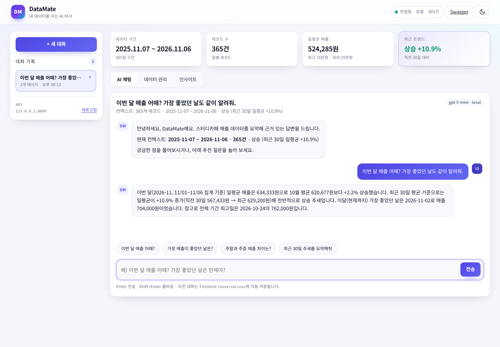
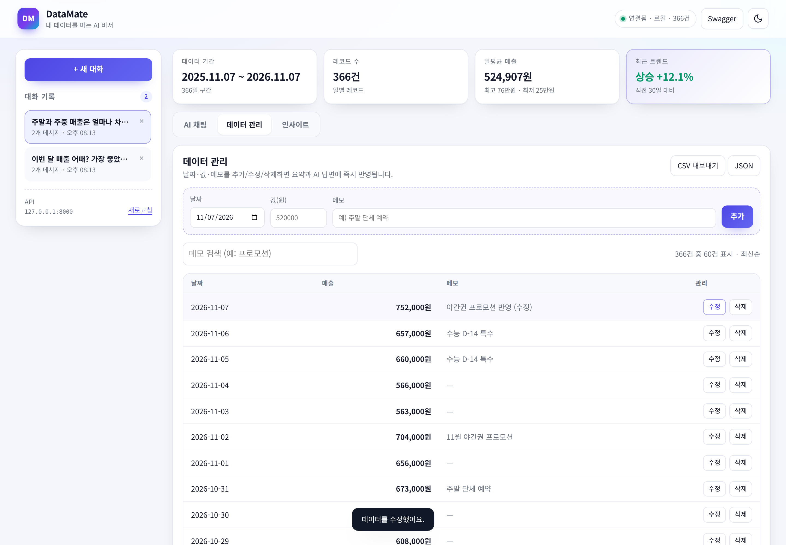
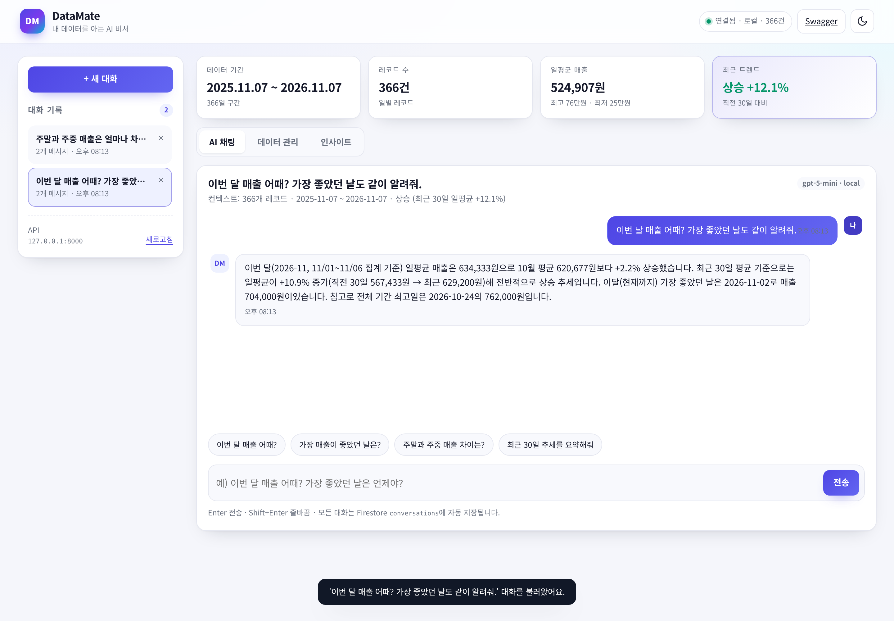
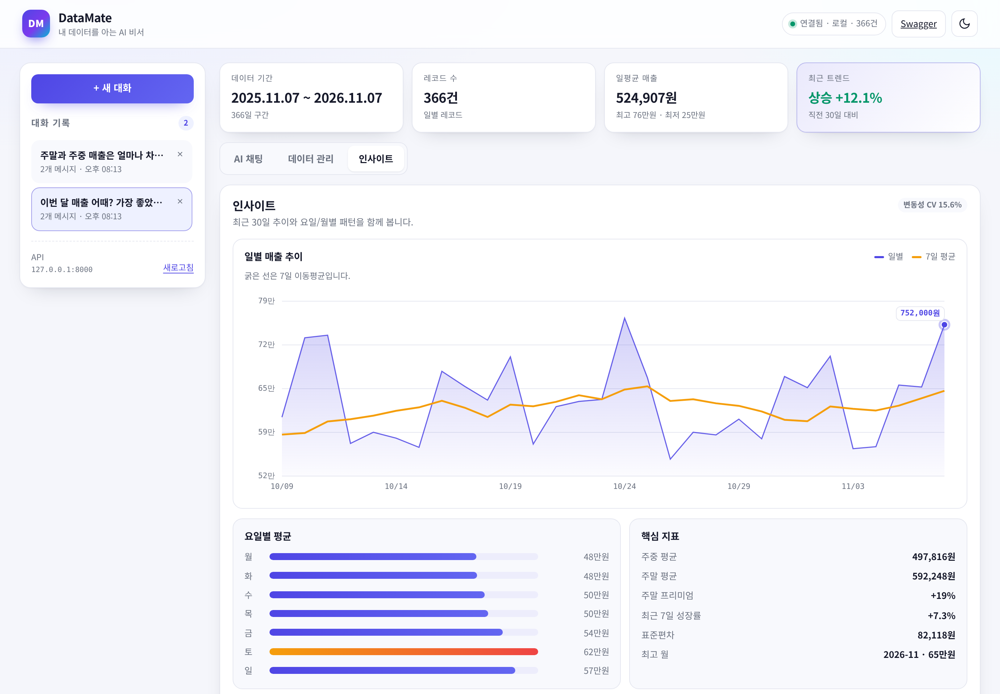
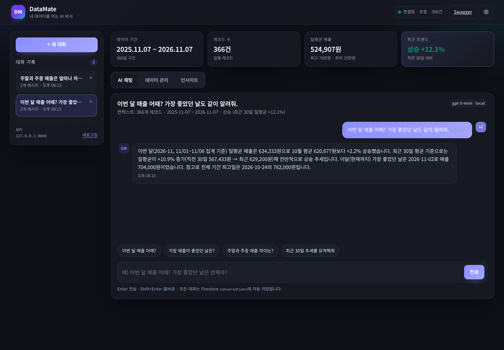
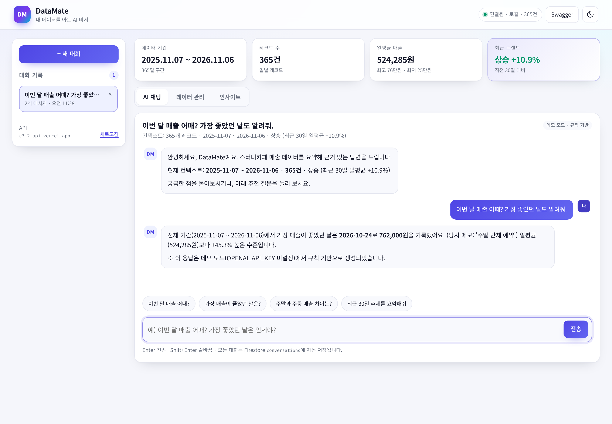
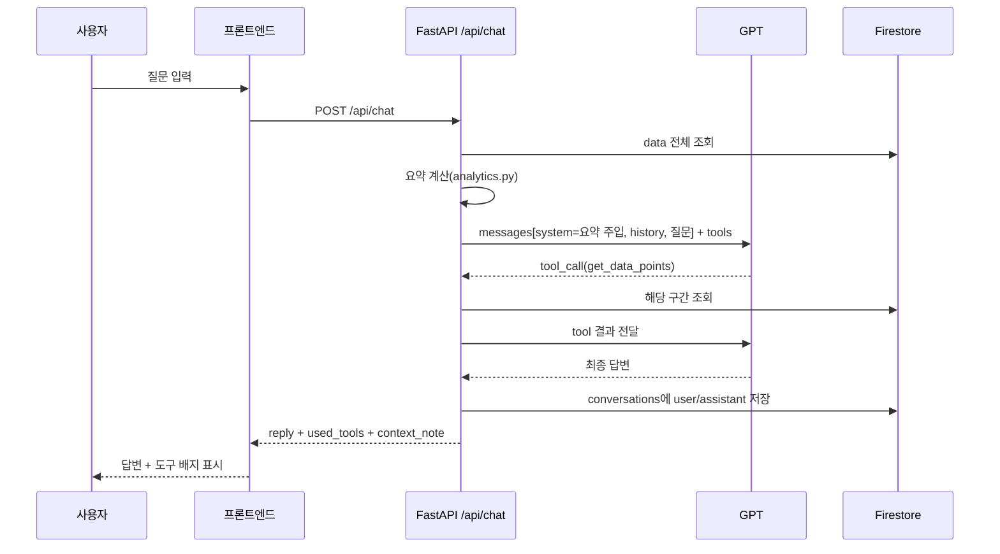

# DataMate — 내 데이터를 아는 AI 비서

> 스터디카페 일별 매출 **365건**을 분석해 요약을 만들고, 그 요약을 GPT의 시스템 프롬프트에 주입해
> "내 상황을 아는" 답변을 돌려주는 웹 서비스입니다.
> 일반 ChatGPT에 "이번 달 매출 어때?"라고 물으면 일반론이 돌아오지만, DataMate는 **실제 수치와 근거**로 답합니다.

| 구분 | 내용 |
| --- | --- |
| 프론트엔드 | Vanilla HTML/CSS/JavaScript (프레임워크 미사용) |
| 백엔드 | FastAPI + Pydantic v2, Swagger UI(`/docs`) |
| 데이터베이스 | Firebase Firestore (`data`, `conversations`) |
| LLM | OpenAI Chat Completions + Function Calling |
| 배포 | 프론트 Vercel / 백엔드 Render |

---

## 1. 무엇을 해결하는가

LLM은 사용자의 DB를 모릅니다. 파인튜닝 없이 개인 데이터를 반영하려면 **질문할 때마다 필요한 컨텍스트를 계산해 프롬프트에 넣어 주는 방식(컨텍스트 주입)** 이 가장 실용적입니다.

DataMate의 처리 흐름은 다음과 같습니다.

1. `data` 컬렉션에서 시계열 레코드를 읽는다.
2. 기간·개수·합계·평균·최대·최소·최근 트렌드를 계산해 **요약 정보**를 만든다.
3. 요약을 시스템 프롬프트에 넣고 GPT를 호출한다. (필요하면 모델이 내부 도구를 직접 호출)
4. 질문/답변을 `conversations`에 자동 저장한다.

### 1.1 요구 기능 → 구현 매핑

| 요구사항 | 구현 |
| --- | --- |
| 데이터 기반 AI 채팅 | `POST /api/chat` (요약 주입 + 도구 호출 + 자동 저장) |
| 데이터 관리(CRUD) | `POST/GET/PUT/DELETE /api/data` + 화면 인라인 수정 |
| 대화 기록 저장·불러오기 | `POST/GET/DELETE /api/conversations`, `GET /api/conversations/{id}` |
| 배포·문서화 | Render/Vercel 구성 파일(`render.yaml`, `vercel.json`) + Swagger + 본 문서 |

### 1.2 화면 미리보기

**① 데이터 요약이 보이는 채팅 화면** — 상단 요약 카드(기간/건수/일평균/트렌드)와 근거 있는 답변, 도구 호출 배지



**② 데이터 관리 화면** — 2026-11-07 데이터를 추가한 뒤 값을 수정(CRUD 동작)하는 장면



**③ 대화 기록 화면** — 목록에서 이전 대화를 선택해 메시지를 다시 불러온 장면



**④ 인사이트(보너스)** — 30일 추이/7일 이동평균, 요일별 평균, 월별 비교



**⑤ 다크 모드(보너스)**



**⑥ 실제 배포본(Vercel)에서 동작 확인** — 프론트는 `c3-2-web`, API는 `c3-2-api` 도메인으로 통신


---

## 2. 배포 URL

| 구분 | URL | 비고 |
| --- | --- | --- |
| 프론트엔드 (Vercel) | <https://c3-2-web.vercel.app> | `API_BASE_URL` 환경변수로 백엔드 주소 주입 |
| 백엔드 API (Vercel) | <https://c3-2-api.vercel.app> | `/api/health`, `/api/data/summary` |
| Swagger UI | <https://c3-2-api.vercel.app/docs> | OpenAPI 문서 |

**라이브 데모 동작 범위**

이 저장소는 계정/키 없이도 화면을 확인할 수 있도록 Vercel에 함께 배포했고, 현재 배포본은
`DEMO_FALLBACK=true`라서 LLM 키가 없을 때 **규칙 기반 데모 응답**(응답 끝에 데모임을 명시)을 돌려줍니다.
데이터 조회·CRUD·대화 저장·인사이트 탭은 모두 실제 API로 동작합니다.

`OPENAI_API_KEY`(그리고 Firestore를 쓰려면 `FIREBASE_SERVICE_ACCOUNT_JSON`)를 환경변수에 넣고 재배포하면
`/api/health`의 `llm_configured`가 `true`로 바뀌면서 **실제 GPT 응답·Firestore 저장**으로 자동 전환됩니다.
운영용 구성은 아래 10장(Render) 절차를 그대로 사용하면 됩니다.

> 무료 티어는 일정 시간 요청이 없으면 슬립 상태가 됩니다. 첫 요청 시 30~60초가 걸릴 수 있어
> 프론트엔드는 로딩 4초 후 **"무료 티어 서버는 첫 요청 시 최대 50초까지 걸릴 수 있어요"** 안내 배너를 띄우고,
> `/api/health`로 상태를 재확인합니다.

---

## 3. 기술 스택

| 계층 | 사용 기술 | 선택 이유 |
| --- | --- | --- |
| API | FastAPI 0.115, Uvicorn | 타입 기반 검증 + 자동 OpenAPI 문서 |
| 검증 | Pydantic v2 | 요청/응답 스키마를 코드로 고정, 422 응답 자동화 |
| 저장 | Firebase Firestore (`firebase-admin`) | 서버리스 환경과 궁합이 좋고 스키마리스 |
| LLM | OpenAI `gpt-4o-mini` (환경변수로 교체 가능) | 비용 대비 한국어 품질, Function Calling 지원 |
| 프론트 | HTML/CSS/JavaScript, Canvas | 프레임워크 금지 조건, 차트도 라이브러리 없이 구현 |
| 배포 | Render(백엔드), Vercel(프론트) | 과제 고정 조건 |

---

## 4. 프로젝트 구조

```text
c3-2/
├── backend/
│   ├── main.py                     # 로컬 실행 진입점 (uvicorn main:app)
│   ├── api/index.py                # Vercel 서버리스 진입점(선택)
│   ├── app/
│   │   ├── main.py                 # 앱 팩토리: CORS, 라우터, 예외 핸들러, 정적 서빙
│   │   ├── core/config.py          # 환경변수 설정(민감정보 하드코딩 금지)
│   │   ├── models/schemas.py       # Pydantic 요청/응답 스키마
│   │   ├── routers/                # data.py, conversations.py, chat.py, meta.py
│   │   ├── services/
│   │   │   ├── analytics.py        # 요약/통계 계산(순수 함수)
│   │   │   ├── prompts.py          # 시스템 프롬프트 = 컨텍스트 주입 지점
│   │   │   ├── ai_service.py       # OpenAI 호출 + Function Calling 루프
│   │   │   ├── chat_service.py     # 채팅 오케스트레이션 + 자동 저장
│   │   │   ├── demo_responder.py   # (시연용) 키 없을 때 규칙 기반 응답
│   │   │   └── bootstrap.py        # 최초 기동 시 시드 데이터 적재
│   │   ├── repositories/           # base.py, firestore_store.py, local_store.py, factory.py
│   │   └── data/seed_rows.py       # 시드 365건(패키지 내장 사본)
│   ├── scripts/                    # generate_seed.py, smoke_test.py
│   └── tests/                      # pytest 10건
├── frontend/
│   ├── index.html
│   ├── css/style.css               # 라이트/다크 테마, 반응형
│   ├── js/{config,api,chart,app}.js
│   └── build-config.js             # Vercel 빌드 시 API_BASE_URL 주입
├── data/seed_data.csv              # 원본 시계열(365행)
├── docs/screenshots/               # README 스크린샷
├── scripts/capture_screenshots.py  # Playwright 자동 캡처
├── render.yaml                     # Render Blueprint
└── .env.example
```

### 4.1 계층을 나눈 기준

| 계층 | 책임 | 이 프로젝트에서의 판단 기준 |
| --- | --- | --- |
| Router | HTTP 입출력, 상태코드, 검증 실패 응답 | "HTTP를 아는 코드"만 둔다. 계산 로직 금지 |
| Service | 도메인 로직(요약 계산, 프롬프트 구성, LLM 호출) | 저장소를 바꿔도 그대로 재사용되어야 하는 코드 |
| Repository | 저장/조회 | Firestore ↔ 로컬 JSON을 같은 인터페이스로 추상화 |
| Model | 스키마 | 요청/응답 계약을 Swagger에 그대로 노출 |

이 분리 덕분에 **로컬 JSON 저장소로도 동일한 API를 테스트**할 수 있고(`STORAGE_BACKEND=local`), Firestore 자격 증명만 넣으면 코드 수정 없이 운영 모드로 전환됩니다.

---

## 5. 컨텍스트 주입 원리

`GET /api/data/summary` 응답 예시(실제 시드 데이터 기준):

```json
{
  "period": { "start": "2025-11-07", "end": "2026-11-06", "label": "2025-11-07 ~ 2026-11-06", "days": 365 },
  "count": 365,
  "metrics": { "total": 191364000, "average": 524285, "max": 762000, "min": 251000, "median": 520000, "latest": 657000 },
  "trend": { "direction": "상승", "change_pct": 10.9, "window_days": 30, "label": "상승 (최근 30일 일평균 +10.9%)" },
  "extremes": {
    "best":  { "date": "2026-10-24", "value": 762000, "memo": "주말 단체 예약" },
    "worst": { "date": "2026-01-01", "value": 251000, "memo": "신정 휴무" }
  }
}
```

이 요약을 `services/prompts.py`에서 아래 형태의 시스템 프롬프트로 조립합니다.

```text
당신은 'DataMate'입니다. 사용자의 시계열 데이터를 근거로 답하는 데이터 분석 비서입니다.
오늘 날짜: 2026-11-07 (Asia/Seoul)

[사용자 데이터 요약]
- 데이터 주제: 1인 스터디카페 일별 매출 (단위: 원)
- 데이터 기간: 2025-11-07 ~ 2026-11-06 (365개 레코드, 365일)
- 합계: 191,364,000원
- 일평균: 524,285원 / 중앙값: 520,000원
- 최고: 2026-10-24 762,000원 (주말 단체 예약)
- 최저: 2026-01-01 251,000원 (신정 휴무)
- 최근 트렌드: 상승 (최근 30일 일평균 +10.9%)
- 최근 7일: 10/31 673,000원 / 11/01 656,000원 / ...
- 주말/주중: 주말 평균 592,248원 (주중 대비 +19.0%)
- 요일별 평균: 월 475,942원, 화 479,... , 토 613,...
- 월별 추이: 2026-08 평균 481,323원, ..., 2026-11 평균 634,333원(+2.2%)

[답변 규칙]
1. 위 수치를 근거로 답하세요. 데이터에 없는 값은 '추정'임을 밝히세요.
2. 금액은 천 단위 구분과 단위(원)을 붙이고, 변화율은 소수 1자리까지 표기하세요.
...
```

**왜 이 방식이 동작하는가**

- 모델은 DB에 접근하지 않습니다. 대신 **매 요청마다 계산된 숫자**가 프롬프트에 들어가므로, 같은 질문에도 데이터가 바뀌면 답이 바뀝니다.
- 원본 365행(≈15KB)을 모두 넣지 않고 **요약 + 최근 7일 + 요일/월별 통계**만 넣어 토큰 비용을 줄였습니다. 세부 값이 필요하면 모델이 `get_data_points` 도구로 해당 구간만 조회합니다.
- 요약 계산은 `services/analytics.py`의 순수 함수라, API·채팅·테스트가 **같은 숫자**를 공유합니다.

---

## 6. API 명세

| Method | Path | 설명 |
| --- | --- | --- |
| GET | `/api/data` | 목록 조회 (`start_date`, `end_date`, `q`, `limit`, `offset`, `order`) |
| POST | `/api/data` | 데이터 추가 (같은 날짜가 있으면 **409**) |
| PUT | `/api/data/{id}` | 날짜/값/메모 부분 수정 |
| DELETE | `/api/data/{id}` | 삭제 |
| GET | `/api/data/summary` | 요약(프롬프트 주입용) |
| GET | `/api/data/statistics` | 확장 통계(보너스): 월별·요일별·변동성·7일 성장률·이동평균 |
| GET | `/api/data/export?format=csv\|json` | 내보내기(보너스) |
| POST | `/api/conversations` | 대화 저장 |
| GET | `/api/conversations` | 대화 목록(메시지 미포함, `includes_messages=false` 명시) |
| GET | `/api/conversations/{id}` | 특정 대화의 **전체 messages** 조회 |
| PATCH | `/api/conversations/{id}` | 제목 수정 |
| DELETE | `/api/conversations/{id}` | 삭제 |
| POST | `/api/chat` | 데이터 기반 질의(자동 저장) |
| GET | `/api/health` | 저장소/모델/건수 상태 |
| GET | `/docs` | Swagger UI |

### 6.1 채팅 요청/응답

```http
POST /api/chat
Content-Type: application/json

{ "message": "이번 달 매출 어때? 가장 좋았던 날도 알려줘.", "conversation_id": null }
```

```json
{
  "conversation_id": "3f4c1a9b7d21",
  "reply": "이번 달(2026-11) 일평균은 634,333원으로 10월 평균 620,677원 대비 +2.2% 올랐어요. ...",
  "messages": [{ "role": "user", "content": "..." }, { "role": "assistant", "content": "..." }],
  "model": "gpt-4o-mini",
  "used_tools": [{ "name": "get_data_points", "arguments": { "start_date": "2026-11-01" }, "ok": true, "summary": "7개 포인트 조회" }],
  "latency_ms": 4120,
  "saved": true,
  "context_note": "366개 레코드 · 2025-11-07 ~ 2026-11-07 · 상승 (최근 30일 일평균 +12.1%)"
}
```

`conversation_id`를 함께 보내면 같은 대화에 이어서 저장되고, 없으면 새 대화가 생성됩니다.

---

## 7. Firestore 구조

```text
data/{pointId}
  date:        "2026-11-06"        # 문자열(YYYY-MM-DD) — 정렬 가능
  value:       657000              # number
  memo:        "수능 D-14 특수"
  created_at:  "2026-11-07T11:05:36.248489Z"
  updated_at:  "2026-11-07T11:05:36.248489Z"

conversations/{conversationId}
  title:       "이번 달 매출 어때? 가장 좋았던 날도…"
  messages:    [{ role: "user", content: "...", created_at: "..." },
                { role: "assistant", content: "...", created_at: "..." }]
  model:       "gpt-4o-mini"
  created_at:  "..."
  updated_at:  "..."
```

- 서비스 계정 키는 **환경변수로만** 읽습니다(`FIREBASE_SERVICE_ACCOUNT_JSON` 또는 `FIREBASE_CREDENTIALS_PATH`).
- 자격 증명이 없으면 `local` 저장소로 자동 폴백해 화면/API를 그대로 검증할 수 있습니다(`STORAGE_BACKEND=auto` 기본값).
- 최초 기동 시 `data`가 비어 있으면 CSV(또는 내장 시드) 365건을 자동 적재합니다.

---

## 8. 로컬 실행 방법

```bash
# 1) 저장소
git clone https://github.com/sunhan888/c3-2.git
cd c3-2

# 2) 가상환경 + 의존성 (Python 3.10+)
python3 -m venv .venv
source .venv/bin/activate
pip install -r backend/requirements.txt

# 3) 환경변수
cp .env.example .env
#   OPENAI_API_KEY, (선택) FIREBASE_SERVICE_ACCOUNT_JSON, ALLOWED_ORIGINS 값을 채웁니다.

# 4) 실행 (백엔드가 프론트엔드도 함께 서빙)
cd backend
uvicorn main:app --reload --port 8000
```

- 앱: <http://127.0.0.1:8000>
- Swagger: <http://127.0.0.1:8000/docs>
- 헬스 체크: <http://127.0.0.1:8000/api/health>

프론트만 따로 띄우려면:

```bash
cd frontend
python3 -m http.server 5500     # http://localhost:5500
# 같은 오리진이 아니면 js/config.js의 API_BASE_URL 또는 ?api=http://127.0.0.1:8000 사용
```

### 8.1 검증 명령

```bash
pip install -r backend/requirements-dev.txt  # 테스트 도구 포함
cd backend
pytest -q                                   # 단위/통합 테스트 10건 (외부 API 불필요)
python scripts/smoke_test.py                # 실행 중인 서버 대상 E2E 스모크(실제 LLM 호출)
python ../scripts/capture_screenshots.py    # README 스크린샷 재생성(Playwright)
```

`pytest`는 `STORAGE_BACKEND=local` + LLM 키 없음(데모 폴백)으로 돌기 때문에 **과금 없이** 전체 API 계약을 검증합니다.

---

## 9. 환경 변수

| 이름 | 필수 | 기본값 | 설명 |
| --- | --- | --- | --- |
| `OPENAI_API_KEY` | ✅ | — | OpenAI 키. 없으면 `/api/chat`은 503, `DEMO_FALLBACK=true`면 규칙 기반 데모 응답 |
| `OPENAI_MODEL` | | `gpt-4o-mini` | 사용할 모델 |
| `OPENAI_MAX_TOKENS` | | `700` | 응답 토큰 상한(추론 모델은 내부적으로 4배 예산) |
| `OPENAI_TEMPERATURE` | | `0.3` | 일반 모델에만 적용 |
| `FIREBASE_SERVICE_ACCOUNT_JSON` | | — | 서비스 계정 JSON 문자열 또는 파일 경로 |
| `FIREBASE_CREDENTIALS_PATH` | | — | 파일 경로만 지정하는 대안 |
| `STORAGE_BACKEND` | | `auto` | `auto`(자격 증명 있으면 Firestore) / `firestore` / `local` |
| `SEED_ON_STARTUP` | | `true` | 비어 있을 때 365건 자동 적재 |
| `ALLOWED_ORIGINS` | | `*` | CORS 허용 도메인(콤마 구분). 배포 시 명시 권장 |
| `DEMO_FALLBACK` | | `false` | LLM 키가 없을 때 규칙 기반 데모 응답 사용 |
| `API_BASE_URL` | ✅(프론트) | — | Vercel 빌드 시 `js/config.js`에 주입되는 백엔드 주소 |

> `.env`는 `.gitignore`에 포함되어 커밋되지 않습니다. Render/Vercel에서는 대시보드 환경변수로 등록합니다.

---

## 10. 배포

### 10.1 백엔드 — Render

**방법 A. Blueprint (권장)**

1. Render → **New → Blueprint** → `sunhan888/c3-2` 선택 (`render.yaml` 자동 인식)
2. 환경변수 입력: `OPENAI_API_KEY`, `FIREBASE_SERVICE_ACCOUNT_JSON`, `ALLOWED_ORIGINS`
3. 배포 완료 후 `https://<service>.onrender.com/docs` 확인

**방법 B. 수동 Web Service**

| 항목 | 값 |
| --- | --- |
| Root Directory | `backend` |
| Build Command | `pip install -r requirements.txt` |
| Start Command | `uvicorn main:app --host 0.0.0.0 --port $PORT` |
| Health Check Path | `/api/health` |

### 10.2 프론트엔드 — Vercel

1. Vercel → **Add New Project** → 같은 저장소 선택
2. **Root Directory**를 `frontend`로 지정 (Framework: Other)
3. Environment Variable: `API_BASE_URL = https://<render-service>.onrender.com`
4. Build Command는 `vercel.json`의 `node build-config.js`가 실행되어 `js/config.js`에 주소가 주입됩니다.

### 10.3 배포 체크리스트

- [ ] Render에 `OPENAI_API_KEY`, `FIREBASE_SERVICE_ACCOUNT_JSON` 등록
- [ ] Render `ALLOWED_ORIGINS`에 Vercel 도메인 추가
- [ ] Vercel `API_BASE_URL`에 Render 주소 설정 후 재배포
- [ ] `https://<render>/docs` 접속 확인
- [ ] 프론트에서 채팅 1회, 데이터 추가 1회 실행해 CORS/키 확인

---

## 11. 보너스 구현

### 11.1 Function Calling (도구 호출)

모델이 필요할 때 내부 API를 스스로 호출합니다. 스키마는 `services/ai_service.py`의 `build_tool_schemas()`에 정의되어 있습니다.

| 도구 | 용도 | 호출 예시 |
| --- | --- | --- |
| `get_data_summary` | 기간/통계/트렌드 요약 | "전체적으로 어때?" |
| `get_data_statistics` | 월별·요일별·변동성 | "요일별로 분석해줘" |
| `get_data_points` | 특정 구간 원본 레코드 | "9/21~9/27 일별로 보여줘" |
| `list_recent_conversations` | 이전 대화 목록 | "지난번에 뭐 물어봤지?" |

**호출 흐름**



실제 실행 로그(로컬):

```text
Q: 2026년 9월 21일부터 9월 27일까지 일별 매출 원본 데이터를 표로 보여줘.
tools: [('get_data_points', True)]
A: 요청하신 2026-09-21 ~ 2026-09-27 일별 매출(원본)은 아래 표입니다. ...

Q: 내가 이전에 어떤 질문들을 했는지 최근 3개만 알려줘.
tools: [('list_recent_conversations', True)]
A: 최근 대화는 총 2건만 저장되어 있어서 ...
```

> MCP Server / GPT Actions 연동은 이번 제출 범위에서 구현하지 않았습니다. 대신 동일한 도구 스키마를 그대로 노출할 수 있도록
> `build_tool_schemas()`를 순수 함수로 분리해 두었습니다. (MCP 서버로 감쌀 때 재사용 지점)

### 11.2 인사이트·UX 고도화

- `GET /api/data/statistics`: 월별 집계(전월 대비), 요일별 지수, 변동성(CV), 최근 7일 성장률, 7일 이동평균, 상위 월
- 프론트 차트: Canvas로 직접 구현(라이브러리 0개) — 일별 라인 + 7일 이동평균 + 마지막 값 라벨
- 내보내기: `GET /api/data/export?format=csv|json` (+ Excel 호환 BOM)
- 다크 모드: CSS 변수 테마 + `localStorage` 유지

---

## 12. 테스트 결과

```text
$ cd backend && pytest -q
..........                                                               [100%]
10 passed in 2.42s
```

| 테스트 | 검증 내용 |
| --- | --- |
| `test_health_and_seed` | 헬스 체크, 시드 100건 이상 |
| `test_summary_contract` | 요약 응답 키/트렌드 방향/최대·최소 관계 |
| `test_statistics_contract` | 요일 7개, 월별·이동평균 존재 |
| `test_data_crud` | 추가 201 / 중복 409 / 수정 / 검색 / 삭제 404 |
| `test_validation_rejects_bad_value` | Pydantic 검증(값 범위, 날짜 형식) → 422 |
| `test_export_csv` | CSV 헤더/다운로드 헤더 |
| `test_chat_injects_context_and_saves` | 시스템 프롬프트에 요약 포함, 대화 2건 저장, 후속 질문 누적 |
| `test_chat_demo_fallback_without_key` | 키 없음 → 데모 응답 |
| `test_conversation_crud` | 목록(messages 미포함) / 상세 / 제목 수정 / 삭제 |
| `test_openapi_documents_endpoints` | Swagger 경로 노출 |

GitHub Actions(`.github/workflows/ci.yml`)에서 push/PR마다 같은 테스트를 자동 실행합니다.

실제 LLM 연동은 `scripts/smoke_test.py`로 별도 확인했습니다.

```text
[OK] 헬스 체크 / 시드 365건 / 요약 계약 / 데이터 추가(201) / 중복 날짜 거부(409)
[OK] 데이터 수정(200) / 메모 검색 / 채팅 응답(200) / 컨텍스트 주입 / 대화 자동 저장
[OK] 후속 질문 / 메시지 누적(4개) / 대화 목록 / 특정 대화 불러오기 / CSV 내보내기
모든 검사 통과
```

---

## 13. 설계 결정과 트러블슈팅

| 주제 | 결정/이슈 | 이유와 해결 |
| --- | --- | --- |
| 날짜 중복 | `POST /api/data`는 같은 날짜에 **409** | 일별 시계열에서 하루 두 값은 분석을 왜곡. 수정은 `PUT`으로 유도 |
| 저장소 추상화 | `Store` ABC + Firestore/Local 구현 | 자격 증명 없이도 전체 기능 검증, 운영 전환 시 코드 변경 없음 |
| 추론 모델 토큰 | `gpt-5-mini` 등은 사고 토큰이 출력 한도에 포함 | `max_completion_tokens`를 4배로 잡고, `finish_reason=length`면 1회 재시도 |
| 모델별 파라미터 | `temperature` 미지원 모델 존재 | 모델명 패턴으로 reasoning 계열 판별 후 파라미터 분기 |
| 차트 캔버스 | 재렌더링마다 캔버스가 2배씩 커짐 | `canvas.width`가 곧 속성값이라 `getAttribute('height')`를 읽으면 누적 확대 → CSS 픽셀(`clientHeight`) 기준으로 계산 |
| 숫자 입력 | `<input type="number" step="1000">` 때문에 원화 값이 검증 실패 | `step="1"`로 변경 (값은 원 단위 정수) |
| CORS | 개발은 `*`, 배포는 도메인 명시 | `ALLOWED_ORIGINS` 콤마 구분, `allow_credentials=false` |
| 콜드 스타트 | Render 무료 티어 슬립 | 4초 후 안내 배너 + `/api/health` 재확인, Swagger 링크 노출 |

---

## 14. 과제 목표에 대한 정리(스스로 설명하기)

1. **시계열 분석 → 요약 → 활용 흐름**: `analytics.build_summary()`가 기간/개수/합계/평균/최대/최소/중앙값/최근 트렌드를 계산하고, 이 dict가 ①`/api/data/summary` 응답 ②채팅 시스템 프롬프트 ③프론트 요약 카드에 동시에 사용됩니다.
2. **FastAPI 구조 분리 기준**: Router는 HTTP만, Service는 도메인 로직, Repository는 저장소 접근. 저장소 교체(Firestore↔로컬)가 서비스 코드에 영향을 주지 않도록 인터페이스를 먼저 정의했습니다.
3. **Pydantic 검증을 쓰는 이유**: 잘못된 날짜/음수 매출이 DB에 들어가면 이후 모든 통계가 오염됩니다. 스키마에서 `gt=0`, `max_length`, `date` 타입을 강제하고 422로 차단합니다.
4. **Firestore CRUD**: `data`/`conversations` 두 컬렉션, 문서 ID는 12자리 hex, `updated_at` 기준 정렬. 서비스 계정은 환경변수로 주입합니다.
5. **컨텍스트 주입 원리**: 모델은 DB를 모르므로 요청 시점에 요약을 만들어 시스템 메시지로 넣는다. 데이터가 바뀌면 같은 질문에도 답이 달라지고, 원본 전체 대신 요약+도구 조회로 토큰을 절약한다.
6. **CORS/환경변수/키 관리**: 브라우저는 다른 오리진의 API를 기본 차단하므로 `ALLOWED_ORIGINS`로 허용 목록을 관리하고, 키는 코드/저장소에 두지 않고 Render·Vercel 환경변수로만 주입합니다.

---

## 15. 라이선스

교육용 과제 결과물입니다. 시드 데이터는 실제 매출이 아닌 재현 가능한 합성 데이터입니다.
